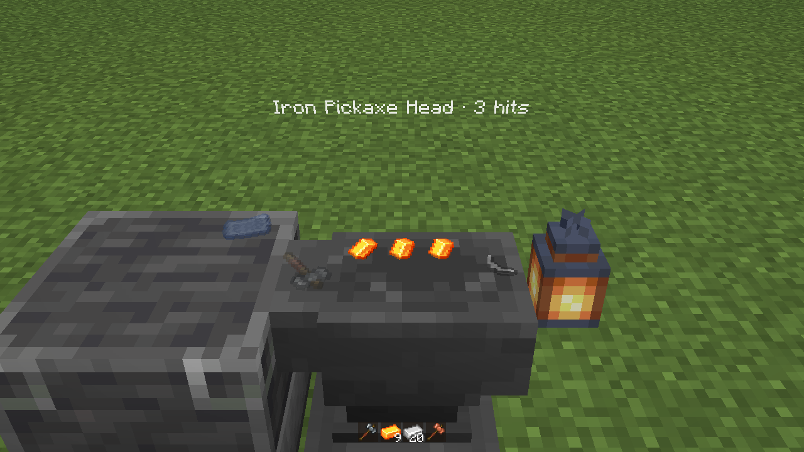
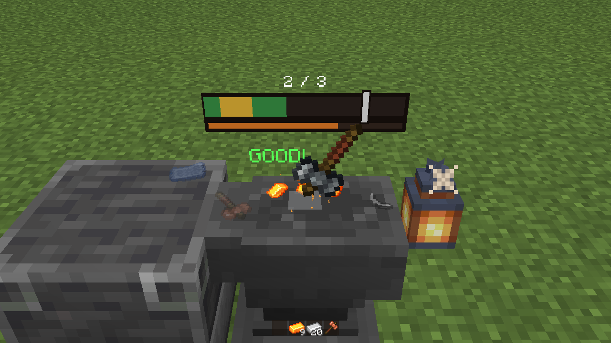
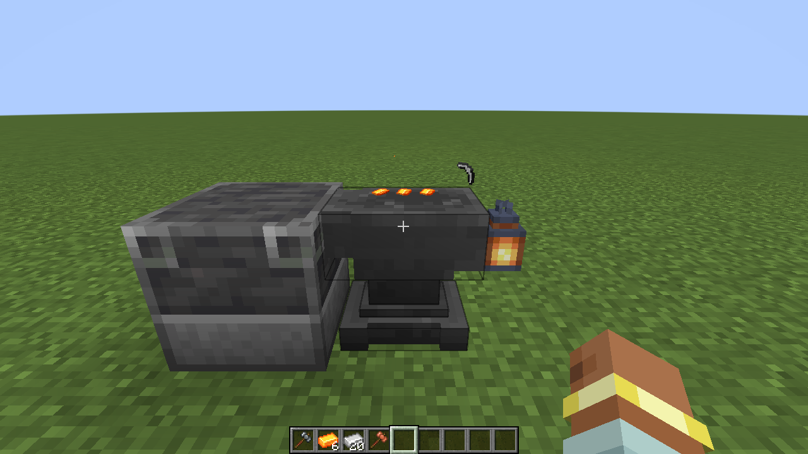
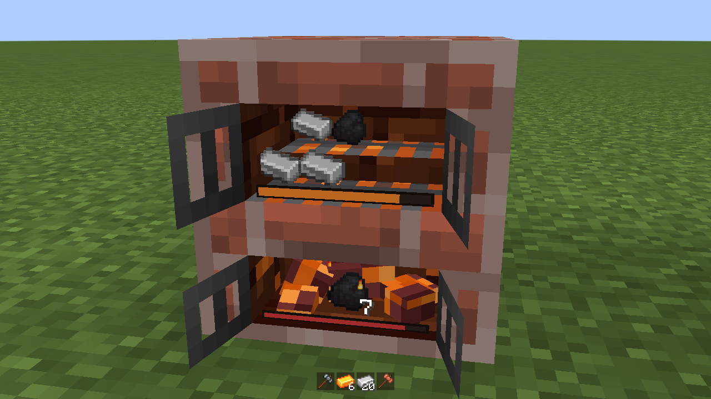

# Hands-On Overgeared

An addon for [Overgeared](https://modrinth.com/mod/overgeared) on **NeoForge 1.21.1**, built on the
[Diegesis](https://modrinth.com/mod/diegesis-api) library, in the spirit of
[Hands-On Delight](https://github.com/Pocky-l/handson-delight): Overgeared's smithing anvil opens **right in the world**,
with no menu screen.

- **The anvil in 3D.** Using the anvil flies the camera to it. The 3x3 forging grid lies on the anvil's face, item by
  item; the hammer rests on the heel, the blueprint hangs beside it, and the finished piece hovers over the horn (its
  ghost shows there as soon as the grid makes something). Drag stacks from the drawer at the bottom of the screen onto
  the anvil, take them back, shift-click, as in any menu.
- **The hammer in hand.** Take the hammer (click the anvil with an empty hand, or click it on the heel / in the drawer):
  over the work the scene draws it raised, following the cursor. A click brings it down: sparks fly, the metal jumps,
  the anvil rings.
- **The forging rhythm.** The first blow starts the forging: a rhythm bar rises over the anvil, its marker running to and
  fro. Strike while it is in the green zone, best in the gold one. Every strike speeds the marker up, narrows the zones
  and moves them, exactly as in Overgeared's minigame, with its settings, difficulties and quality thresholds. A floating
  *PERFECT! / GOOD / MISS* shows how each blow landed; at the last one the piece is made with its quality.
- **The furnaces.** The alloy furnace, the nether alloy furnace and the casting furnace open as the furnace of
  Hands-On Vanilla: the block steps aside for a copy whose front is cut exactly where Overgeared's own texture draws its
  dark openings: the shallow vents (they glow while it burns), the firebox arch and the casting furnace's mouth. Iron
  grille doors (after Hands-On Vanilla's) swing open on the arch and the mouth. The alloy furnaces take what they smelt in
  a crucible sunk into the front of their top (two by two, or three by three), the result over the rim; the casting
  furnace takes its metal and its cast on the grate in its mouth. The fuel lies among the coals of the arch. While it
  burns the lining glows, the coals turn to embers and flames lick up; a strip on the top (or on the mouth's lip) fills as
  it smelts, one on the arch floor shows the fuel left. Taking the result gives the experience the furnace stored.
- **Everyone sees it.** Players nearby see the bar, the marker, the hammer blows and the sparks of whoever is forging.
- **Nothing replaced.** The items stay in Overgeared's own anvil inventory. Sneaking + use keeps Overgeared's screen and
  its own minigame; hoppers, blueprints, quality, the creator's name, advancements and recipe unlocks work as before. Hot
  metal does not cool while you work at the anvil (as with its screen open). Recipes without quality are hammered blow by
  blow, with a progress strip. The mod adds no blocks or items: a player without it keeps the usual screen.

| The work laid out on the anvil | A strike in rhythm | Left alone | The alloy furnace |
|---|---|---|---|
|  |  |  |  |

## Requirements

| | Version |
|---|---|
| Minecraft | 1.21.1 |
| NeoForge | 21.1.253 or newer |
| Overgeared | 1.21.1-1.7.0 or newer (NeoForge) |
| Diegesis | 1.0.0-beta.14 or newer |

Install on the client and on the server.

## Building

```bash
./gradlew build
```

The jar is in `build/libs/`. `./gradlew runClient` starts a dev client with Overgeared and Diegesis.

`./gradlew runShots` (dev only) builds a flat test world, works the anvil with the mouse and saves screenshots to
`shots/`; it runs headless under `xvfb-run` too.

## How it works

- `station/AnvilStation` declares the Diegesis station on every Overgeared smithing anvil (stone and every configured
  tier), its slot groups bound to the anvil's own slots.
- `station/AnvilLogic` is the server side: it starts a forging, counts how strikes landed, sets the anvil's quality before
  the last strike and lets Overgeared's own `increaseForgingProgress` make the piece.
- `station/ForgeRhythm` is Overgeared's minigame made deterministic: zones from a seed and the strike count, the marker
  from where it was at the last strike, so every client draws the same bar from the station's data.
- `furnace/` holds the furnaces: their stations, their logic (the fire and progress read through mixin accessors) and
  `client/FurnaceBehavior`, which swings the door and draws the fire and the bars.
- `client/AnvilBehavior` draws the hammer and its swing, the rhythm bar, the popups and the sparks.
- `assets/handson_overgeared/diegesis/scenes/smithing_anvil.json` is the scene: camera, slots and nodes.

## License

MIT. The furnace lining and grate textures come from
[Hands-On Vanilla](https://github.com/Pocky-l/handson-vanilla) (MIT, Pocky).
